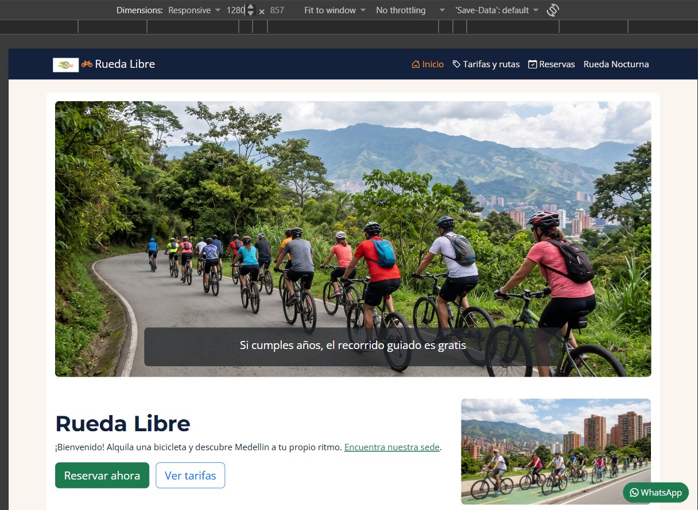
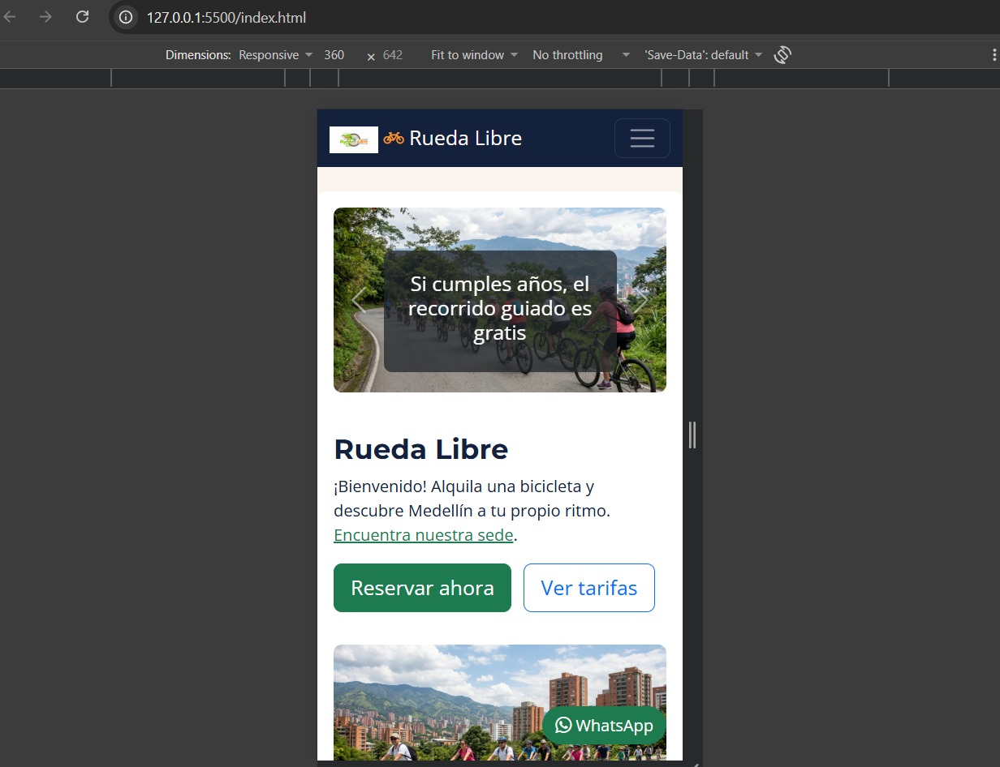
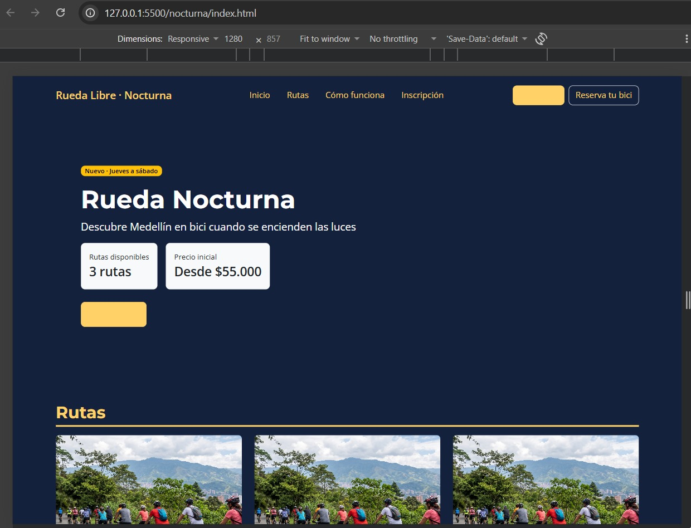
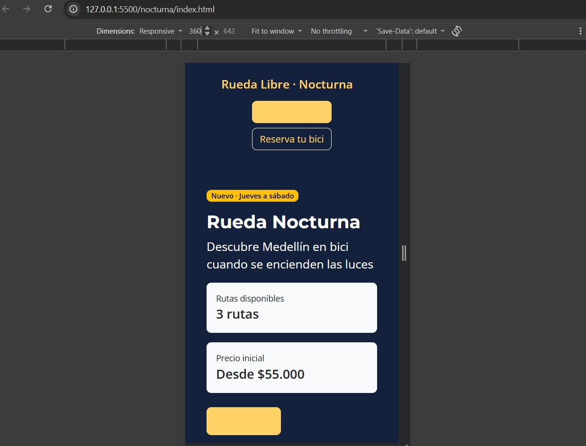

# Rueda Libre

Sitio web estático para **Rueda Libre**, un servicio de alquiler de bicicletas y recorridos guiados en Medellín. La campaña **Rueda Nocturna** amplía la oferta con rutas guiadas de jueves a sábado. El ecosistema presenta servicios, tarifas, reservas, rutas diurnas y nocturnas y un kit de componentes de marca.

## Páginas

| Página | Descripción |
| --- | --- |
| [`index.html`](./index.html) | Inicio, promociones, flota, rutas y servicios. |
| [`paginas/tarifas.html`](./paginas/tarifas.html) | Tarifas de alquiler y recorridos guiados. |
| [`paginas/reservas.html`](./paginas/reservas.html) | Formulario de reserva y horarios. |
| [`nocturna/index.html`](./nocturna/index.html) | Landing de Rueda Nocturna, planes e inscripción. |
| [`nocturna/componentes.html`](./nocturna/componentes.html) | Muestra de botones, tarjeta, alertas y campos. |
| [`nocturna/prototipo.html`](./nocturna/prototipo.html) | Prototipo del hero de campaña. |

**GitHub Pages:** publicación completada.

- Sitio principal Rueda Libre v2.0: [https://nickmarinm.github.io/ruedaLibre/](https://nickmarinm.github.io/ruedaLibre/)
- Landing Rueda Nocturna: [https://nickmarinm.github.io/ruedaLibre/nocturna/](https://nickmarinm.github.io/ruedaLibre/nocturna/)

## Estructura

```text
.
├── index.html
├── paginas/
│   ├── tarifas.html
│   └── reservas.html
├── nocturna/
│   ├── index.html
│   ├── componentes.html
│   └── prototipo.html
├── css/
│   └── styles.css
├── img/
│   ├── logo.png
│   ├── portada.jpg
│   ├── bicicleta.jpg
│   ├── ruta.jpg
│   └── capturas/          # espacio para evidencias visuales
└── bitacora.txt
```

## Tecnologías y arquitectura

- HTML5 semántico y CSS3 para estructura, identidad visual y modo oscuro.
- Bootstrap 5.3 CSS y Bundle JavaScript mediante CDN; Bootstrap Icons también se carga por CDN en el sitio principal.
- Google Fonts: Montserrat 700 y Open Sans 400/600.
- No requiere Node.js, npm, Tailwind ni compilación. Se necesita conexión a internet para cargar los recursos CDN.
- HTML aporta la estructura (por ejemplo, tablas y formularios), CSS la presentación (colores y tipografía) y JavaScript la interacción (navbar, carrusel, modal y validación visual).
- Flexbox se utiliza para distribuir elementos en un eje (encabezados y pies); las filas y columnas de Bootstrap organizan tarjetas y formularios en dos dimensiones.
- El diseño es Mobile-First: las rutas usan una columna en celular, dos desde `sm` y tres desde `lg`; los cuatro pasos cambian de una a dos y cuatro columnas. Los encabezados ocultan sus enlaces secundarios en móvil y conservan visible la acción principal.

### Componentes integrados

El sitio principal incorpora navbar colapsable, botones de acción, carrusel promocional, tarjetas de flota y rutas, validación `needs-validation`, alerta descartable, modal de políticas y Bootstrap Icons. La campaña nocturna añade cards de rutas y planes, preinscripción y componentes de revisión. La personalización se realiza con variables `--bs-*` y clases de marca, sin modificar Bootstrap ni añadir `!important`.

## Navegación y recursos

| Origen | Destino | Ruta relativa |
| --- | --- | --- |
| `index.html` | Tarifas | `paginas/tarifas.html` |
| `index.html` | Reservas | `paginas/reservas.html` |
| `index.html` | Rueda Nocturna | `nocturna/index.html` |
| `paginas/tarifas.html` y `paginas/reservas.html` | Inicio | `../index.html` |
| `paginas/tarifas.html` y `paginas/reservas.html` | Rueda Nocturna | `../nocturna/index.html` |
| `paginas/tarifas.html` | Reservas | `reservas.html` |
| `paginas/reservas.html` | Tarifas | `tarifas.html` |
| `nocturna/index.html` | Inicio | `../index.html` |
| `nocturna/index.html` | Tarifas y reservas | `../paginas/tarifas.html`, `../paginas/reservas.html` |
| `nocturna/index.html` | Imagen de ruta | `../img/ruta.jpg` |
| `nocturna/prototipo.html` | Reservas | `../paginas/reservas.html` |

| Archivo | Recursos de imagen |
| --- | --- |
| `index.html` | `img/logo.png`, `img/portada.jpg`, `img/bicicleta.jpg`, `img/ruta.jpg` |
| `paginas/tarifas.html` y `paginas/reservas.html` | `../img/logo.png` |
| `nocturna/index.html` y `nocturna/componentes.html` | `../img/ruta.jpg` |
| `nocturna/prototipo.html` | No usa imágenes |

Las páginas usan `header`, `nav`, `main`, `section`, `article`, `aside` y `footer` donde corresponde, títulos jerárquicos, texto alternativo, tablas con encabezados de ámbito y etiquetas de formulario asociadas. La reserva principal y la inscripción nocturna combinan restricciones nativas con validación visual de Bootstrap.

### Análisis HTTP y pruebas de formularios

Con Live Server, `http://127.0.0.1:5500/index.html` representa una solicitud `GET` local que debe responder `200 OK`. Una dirección inexistente como `/promociones.html` devuelve `404 Not Found`.

| Caso de formulario | Regla | Resultado esperado | Registro |
| --- | --- | --- | --- |
| Nombre `Al` | `minlength="3"` | Rechazado | Prueba interactiva no ejecutada |
| Documento `12AB567` | 6–10 dígitos | Rechazado | Prueba interactiva no ejecutada |
| Celular que inicia en 2 o tiene 9 dígitos | Patrón `3[0-9]{9}` | Rechazado | Prueba interactiva no ejecutada |
| Fecha `2027-01-01` | Rango hasta `2026-12-31` | Rechazada | Prueba interactiva no ejecutada |
| Cantidad `0` o `7` | Mínimo 1, máximo 6 | Rechazada | Prueba interactiva no ejecutada |
| Comentario de 301 caracteres | `maxlength="300"` | No permite exceder el límite | Prueba interactiva no ejecutada |
| Políticas sin aceptar | Campo requerido | Envío bloqueado | Prueba interactiva no ejecutada |
| Inscripción nocturna | Nombre, correo, celular, ruta, día, acompañantes, experiencia, bicicleta propia y condiciones | Validación nativa y visual | Prueba interactiva no ejecutada |

## Decisiones de estilo, responsive y accesibilidad

### Flexbox, Grid y pruebas por ancho

Flexbox se eligió para el encabezado y el pie, que distribuyen elementos en un eje y cambian de columna a fila desde `md`. La grilla `row`/`col-*` se usa para portada, flota, rutas, planes, pasos y formularios, donde importan filas y columnas. En la flota original, `repeat(auto-fit, minmax(16rem, 1fr))` se calculó como 3 columnas a 1280 px, 3 a 900 px y 1 a 500 px; el cálculo no se midió en DevTools.

| Ancho | Riesgo inicial | Encabezado | Rutas | Pasos | Pie |
| --- | --- | --- | --- | --- | --- |
| 360 px | Navegación y tarjetas estrechas | Enlaces secundarios ocultos; CTA visible | 1 columna | 1 columna | Apilado |
| 768 px | La tercera ruta pasaba a otra fila | Enlaces visibles | 2 columnas | 2 columnas | En fila |
| 1024 px | Los cuatro pasos requieren ancho | En fila | 3 columnas | 4 columnas | En fila |
| 1280 px | Sin riesgo registrado | Contenido centrado | 3 columnas | 4 columnas | En fila |

La matriz documenta el comportamiento previsto por los breakpoints Bootstrap, no observaciones visuales de DevTools.

### Accesibilidad, contraste y modo oscuro

Se usan `lang="es"`, atributos `alt`, enlaces descriptivos, controles con `label` asociado, mensajes de error específicos, foco visible y tablas accesibles. El umbral de contraste WCAG para texto normal es 4.5:1.

Validación W3C: [`paginas/reservas.html`](./paginas/reservas.html) y [`nocturna/index.html`](./nocturna/index.html) verificadas con el validador oficial sin errores.

| Texto / fondo | Contraste registrado | Uso |
| --- | ---: | --- |
| Blanco / Verde Ruta | 5.31:1 | Apto para texto normal |
| Azul Noche / Naranja Pedal | 7.20:1 | Apto para texto normal |
| Azul Noche / Crema | 14.82:1 | Apto para texto normal |
| Gris Asfalto / Crema | 5.57:1 | Apto para texto normal |
| Verde Ruta / Crema | 4.93:1 | Apto para texto normal |
| Blanco / Naranja Pedal | 2.22:1 | No apto para texto normal |
| Naranja Pedal / Crema | 2.06:1 | No apto para texto normal |
| Amarillo Farol / Azul Noche | Más de 11:1 | Apto para texto normal |
| Verde Ruta / Azul Noche | Aproximadamente 3:1 | No apto para texto normal |
| Crema / Azul Noche | Más de 14:1 | Apto para texto normal |

Las páginas nocturnas aplican `data-bs-theme` según `prefers-color-scheme` y escuchan cambios en tiempo real. En tema oscuro, enlaces y acentos usan Amarillo Farol; los botones Farol usan texto Azul Noche.

### Cascada y fundamentos de CSS

`styles.css` se enlaza después de Bootstrap para que prevalezcan las reglas de marca cuando tienen igual especificidad. `font-family` y `color` se heredan del `body`; propiedades como `padding` y `background-color` no se heredan. Los selectores con ID tienen más especificidad que los de clase y tipo; el proyecto evita `!important`.

En un ejemplo de caja con ancho de contenido de 320 px, padding total de 32 px y bordes de 2 px, `content-box` ocupa 354 px en total; `border-box` limita el exterior a 320 px y deja 286 px de contenido.

| Utilidad Bootstrap | Uso |
| --- | --- |
| `text-bg-success` | Fondo de éxito con color de texto contrastante. |
| `d-none d-md-block` | Oculta el elemento hasta el breakpoint `md`. |
| `flex-md-row` | Cambia la dirección Flexbox a fila desde `md`. |
| `g-4` | Aplica separación entre columnas y filas. |
| `py-2` | Aplica padding vertical. |

### Registro histórico de migración

- La migración de CSS Grid a Bootstrap cambió la grilla de flota por `row g-4` y `col-12 col-sm-6 col-lg-4 col-xl-3`. En esa etapa, el registro anotó 414 líneas de CSS antes y 100 después; no es el conteo actual, que incluye personalización de marca y modo oscuro.
- La ventaja registrada fue reducir reglas de distribución propias y obtener breakpoints uniformes; los costos son dependencia del CDN y menor control directo sobre tracks. El tiempo de desarrollo no se midió.
- La primera versión cubrió estructura HTML, rutas relativas, análisis de HTTP, tablas, formularios nativos, accesibilidad, herencia, especificidad y box model; las iteraciones posteriores añadieron Mobile-First, Bootstrap, componentes e identidad nocturna.

## Variables de marca

La hoja [`css/styles.css`](./css/styles.css) centraliza variables de marca: Verde Ruta (`#1E7A4F`), Naranja Pedal (`#F39A2B`), Azul Noche (`#14213D`), Crema (`#FAF6EF`), Gris Asfalto (`#5B6470`) y Amarillo Farol (`#FFD166`), además de las fuentes Montserrat y Open Sans. Las variables `--bs-*` personalizan Bootstrap sin editar sus archivos fuente.

## Comparativa de frameworks: Bootstrap 5.3 y Tailwind CSS

| Criterio | Bootstrap 5.3 | Tailwind CSS |
| --- | --- | --- |
| Curva de aprendizaje | Componentes y convenciones listas para usar. | Requiere combinar utilidades y conocer el sistema de diseño. |
| Personalización | Variables CSS y componentes con estilos definidos. | Ajustes detallados mediante utilidades y configuración del tema. |
| Tamaño final | El CDN entrega la hoja compartida, incluso si algunas reglas no se usan. | Un proceso de compilación puede excluir clases no utilizadas y reducir el CSS final. |
| Casos de uso | Prototipado rápido y componentes consistentes. | Interfaces a medida cuando se dispone de un flujo de compilación. |

Se mantiene Bootstrap 5.3 para conservar una sola tecnología de interfaz, aprovechar los componentes y CDN ya integrados y evitar añadir Node.js o una compilación al sitio estático. El conteo histórico de CSS se refiere a la migración inicial, no a la hoja actual, que posteriormente recibió estilos de marca y modo oscuro.

## Evidencias y registro

- **Vista escritorio del sitio principal Rueda Libre:** 
- **Vista móvil 360 px del sitio principal Rueda Libre:** 
- **Vista escritorio de Rueda Nocturna:** 
- **Vista móvil y/o modo oscuro de Rueda Nocturna:** 
- Registro técnico detallado: [`bitacora.txt`](./bitacora.txt).

## Autor y aprendizajes

**Autor:** Nicolas Marin C

Durante el desarrollo se aplicaron HTML semántico y accesible, navegación con rutas relativas, diseño responsive con Bootstrap, validación de formularios, personalización mediante variables CSS y adaptación al modo oscuro. También se practicó documentar decisiones técnicas y distinguir entre diagnósticos estáticos y pruebas visuales ejecutadas.
